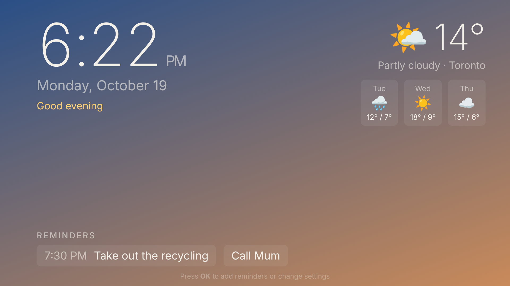

# Ambient TV

A full-screen ambient dashboard for your TV: a large clock, local weather with a
3-day forecast, and your reminders. It's a plain web app (no build step), so it
runs on any TV or streaming device that can show a web page.



## Features

- **Clock and date**, with a background that shifts colour through the day
- **Weather** from [Open-Meteo](https://open-meteo.com) (free, no API key)
- **Reminders**, optionally with a time. A reminder is highlighted when it's due within the hour.
- **Remote-friendly controls**: press **OK** to open the panel, use the arrows to
  move around, and press **Back** to close it
- **Burn-in protection**: the layout drifts slightly every couple of minutes, which is safer for OLED screens

Reminders and settings are saved on the device you're using (in the browser's local storage).

## Try it

Open `web/index.html` in any browser, or serve it:

```sh
cd web && python3 -m http.server 8080
# then visit http://localhost:8080
```

Press Enter (or click), add a reminder, and set your city.

## Putting it on a TV

| Device | How |
| --- | --- |
| Google TV / Android TV / Fire TV | Host the `web/` folder somewhere (e.g. GitHub Pages), then open it in a kiosk browser such as Fully Kiosk Browser. A native wrapper app (and screensaver mode) is planned. |
| Samsung (Tizen) | Package `web/` as a Tizen web app with Tizen Studio and install it via Developer Mode. |
| LG (webOS) | Package `web/` with the webOS CLI (`ares-package`) and install it via the Developer Mode app. |
| Apple TV | tvOS has no web view; this would need a native SwiftUI app built in Xcode on a Mac. |
